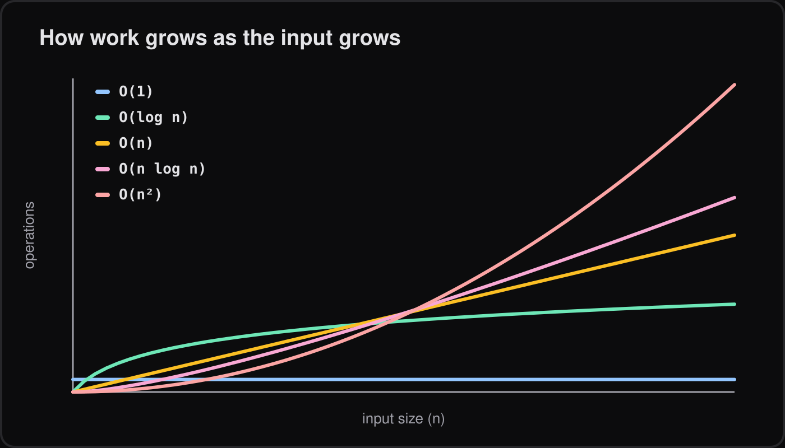

Big-O has a reputation as interview trivia, but the idea is small and useful. You do not need the maths; you need a feel for how code slows down as data grows.

## What Big-O answers

Big-O describes how the amount of work grows as the input grows. It does not tell you how many milliseconds something takes. It tells you what happens when `n` goes from a thousand to a million.

## The classes you actually meet

Five cover almost everything in day-to-day web code.

### O(1) and O(log n)

Constant time means the work does not depend on input size. Reading an array index is the typical example.

```js
const firstItem = items[0];
```

Logarithmic time means each step discards half the remaining data. Binary search on a sorted array is the standard case.

```js
function binarySearch(sorted, target) {
  let lo = 0;
  let hi = sorted.length - 1;
  while (lo <= hi) {
    const mid = Math.floor((lo + hi) / 2);
    if (sorted[mid] === target) return mid;
    if (sorted[mid] < target) lo = mid + 1;
    else hi = mid - 1;
  }
  return -1;
}
```

A million items need only about twenty steps.

### O(n), O(n log n) and O(n^2)

Linear time touches each item once. `find` is O(n) in the worst case, because it may scan the whole array.

```js
const user = users.find((u) => u.id === id);
```

Good general-purpose sorting is O(n log n), which is what `Array.prototype.sort` gives you in practice.

```js
const sorted = [...numbers].sort((a, b) => a - b);
```

Quadratic time usually means a loop inside a loop over the same data.

```js
for (let i = 0; i < items.length; i++) {
  for (let j = i + 1; j < items.length; j++) {
    if (items[i] === items[j]) console.log("duplicate", items[i]);
  }
}
```

As `n` grows, the curves diverge dramatically, and the quadratic one is the one that eventually hurts.



## Dropping constants and lower terms

If a function does `3n + 10` operations, we call it O(n). Constants and smaller terms stop mattering as `n` grows, so Big-O keeps only the dominant one. Two sequential loops are still O(n), while a loop nested in a loop is O(n^2).

## A practical fix: includes versus Set

This is the most common real-world win I see. Calling `includes` inside a loop scans an array each time.

```js
// O(n^2): includes scans b for every item in a
function commonSlow(a, b) {
  return a.filter((x) => b.includes(x));
}

// O(n): building the Set is linear, each has() is constant on average
function common(a, b) {
  const lookup = new Set(b);
  return a.filter((x) => lookup.has(x));
}
```

The trade is a bit of extra memory for a much faster lookup.

## For small n, measure

Big-O ignores constants, and for small inputs constants dominate. A simple array scan over 20 items can beat a `Set` because of lower overhead. Before optimising, measure with realistic data.

```js
const a = Array.from({ length: 20000 }, (_, i) => i);
const b = Array.from({ length: 20000 }, (_, i) => i * 2);

console.time("includes");
commonSlow(a, b);
console.timeEnd("includes");

console.time("set");
common(a, b);
console.timeEnd("set");
```

`performance.now()` works too if you want the numbers in code. Measuring instead of guessing is also the heart of [habits for debugging faster](/blog/debugging-habits/).

## Space complexity in a paragraph

Space complexity asks the same question about memory. `commonSlow` uses O(1) extra space apart from its result, while `common` uses O(n) for the `Set`. Faster code often costs memory, so it is worth knowing which resource is scarcer in your situation.

## What to do next

Pick a hot path in your own code, such as a loop that calls `includes`, `indexOf` or `find`, and ask what happens at ten times the data. If the answer is "much worse", try a `Set` or `Map`, then measure before and after.
