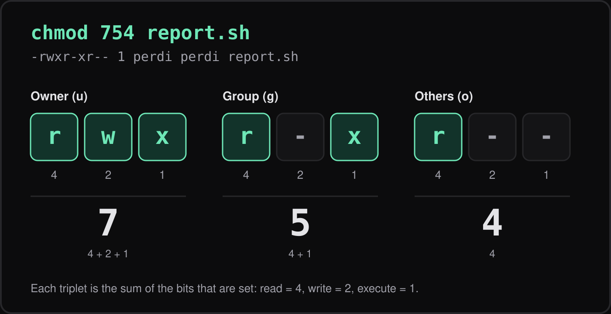

Permission errors are one of the first walls newcomers hit on Linux, and "fixing" them with brute force is a habit that causes real security problems. The model is small enough to learn in one sitting, so let's do that.

## Reading ls -l output

```bash
ls -l deploy.sh
# -rwxr-xr-- 1 perdi devs 1204 Mar  3 10:12 deploy.sh
```

The first column is ten characters. The first is the type (`-` file, `d` directory, `l` symlink). The remaining nine are three triplets: owner (user), group, and others. Each triplet shows read (`r`), write (`w`), and execute (`x`), or `-` when missing. After the link count come the owning user (`perdi`) and owning group (`devs`).

The kernel checks in order: if you are the owner, the owner triplet applies; otherwise, if you are in the group, the group triplet applies; otherwise the others triplet does. It never combines them.

## Numeric and symbolic chmod

Each permission has a value: read is 4, write is 2, execute is 1. Add them up per triplet and you get an octal digit. For `754`, the owner gets rwx (7), the group gets r-x (5), and others get r-- (4).



Both styles do the same job:

```bash
chmod 754 deploy.sh          # numeric: set everything at once
chmod u=rwx,g=rx,o=r deploy.sh   # symbolic: same result
chmod +x script.sh           # add execute for everyone
chmod g-w,o-rwx secrets.env  # tweak only what you mean to
chmod -R u+rwX,go-w project/ # capital X: execute only on directories
```

I prefer symbolic mode for small adjustments because it does not clobber bits I did not mention.

## Directories behave differently

On a directory, `r` lets you list names, `w` lets you create or delete entries inside, and `x` lets you traverse it, meaning access items by path. Without `x` on a directory you cannot `cd` into it or open files within, even if the files themselves are readable. This is why web server errors often trace back to a parent directory missing `x`.

## Changing ownership

```bash
sudo chown perdi file.txt              # change owner
sudo chown perdi:devs file.txt         # owner and group
sudo chown -R www-data:www-data /srv/site
chgrp devs shared/                     # change group only
```

Only root can change a file's owner. A regular user can change the group to one they belong to.

## What umask does

New files do not start at 777. The shell's `umask` removes bits from the defaults: 666 for files, 777 for directories. With the common `022`, write is removed for group and others, giving 644 files and 755 directories.

```bash
umask          # 0022
umask 077      # private by default: 600 files, 700 directories
touch a && mkdir b && ls -ld a b
```

Set it in `~/.bashrc` if you want a stricter default. A umask of `077` suits a personal machine holding keys and tokens.

## setuid, setgid, and the sticky bit

These are special bits shown in a fourth, leading octal digit.

- setuid (4): an executable runs as its owner. `passwd` uses this.
- setgid (2): on a directory, new files inherit the directory's group, which is useful for shared project folders.
- sticky (1): in a directory like `/tmp`, only a file's owner can delete it.

```bash
chmod 2775 shared/    # setgid + rwxrwxr-x
chmod +t /srv/drop    # sticky bit
```

Be careful with setuid on anything you write yourself.

## Common mistakes

- Running `chmod 777` to make an error disappear. It lets every user modify the file, and it hides the real cause. Find out which user needs access and grant exactly that.
- Using `chmod -R 755` on a tree, which marks every data file executable.
- Making SSH keys group- or world-readable; `ssh` refuses them. Use `chmod 600 ~/.ssh/id_ed25519`.
- Forgetting that `sudo` creates root-owned files in your project.

## What to do next

Run `ls -l` in your home directory and explain every column to yourself. Then audit one real project: check what owns your deployment directory and whether any file is more open than it needs to be. If you are still getting comfortable with the shell, start with [Linux terminal essentials](/blog/linux-terminal-essentials/).
